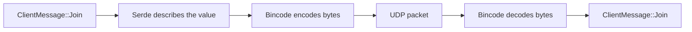
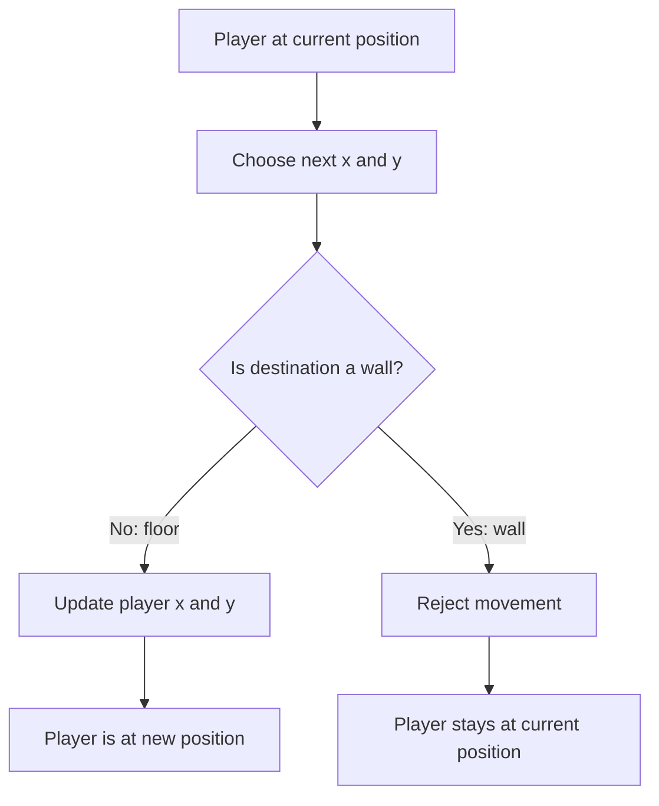

# Multiplayer FPS Project Walkthrough

This guide explains how the example project works as a complete system. Use it to understand the design before building your own version.

## 1. The Big Picture

The game has two programs:

```text
Server                         Client
------                         ------
Owns the real game state      Displays the world
Moves and validates players   Reads keyboard and mouse
Decides hits and deaths       Sends input to server
Sends snapshots               Receives snapshots
```

The server is authoritative. A client cannot decide that its own shot hit another player. It can only send an input request. The server validates the request and broadcasts the result.

## 2. Important Files

| File | Responsibility |
| --- | --- |
| `src/bin/server.rs` | Starts the server and chooses its bind address |
| `src/bin/client.rs` | Starts Macroquad and runs the client state machine |
| `src/server/game_server.rs` | Lobby, simulation, movement, combat, rounds, snapshots |
| `src/client/network.rs` | UDP connection and message serialization |
| `src/client/renderer.rs` | Raycasting, sprites, HUD, minimap, and effects |
| `src/common/protocol.rs` | Messages and data shared by client and server |
| `src/common/player.rs` | Player state and health/stat helpers |
| `src/common/maze.rs` | Grid storage, maze generation, and spawn selection |
| `Cargo.toml` | Rust package, binaries, and dependencies |

## 3. Startup Event Flow

### Server startup

1. `server.rs` reads a command-line address, environment variable, or default address.
2. `GameServer::bind` opens a nonblocking UDP socket.
3. The server generates an initial maze.
4. The server starts in `GamePhase::Lobby`.
5. `GameServer::run` begins its continuous loop.

Run it with:

```sh
cargo run --bin server
```

### Client startup

1. `client.rs` creates a fullscreen Macroquad window.
2. The client starts in the menu state.
3. The user enters a server address and username.
4. `NetClient::connect` binds a local UDP socket.
5. `NetClient::join` sends a join request.

Run it with:

```sh
cargo run --bin client
```

## 4. Joining the Server

The client sends a `ClientToServer::Join` message containing a username and skin.

The server then:

1. Checks whether the server is full.
2. Validates the username.
3. Checks duplicate names.
4. Assigns a unique player ID.
5. Chooses a floor tile as a spawn point.
6. Creates a `Player` with 100 health.
7. Stores the client's `SocketAddr`.
8. Sends `ServerToClient::JoinOk` back to that client.
9. Broadcasts the current lobby state.

The join response includes the maze dimensions and tile data so every client can render the same map.

## 5. Client States

The client uses a state machine:

```text
Menu -> WaitingRoom -> Playing -> Winner
  ^         |             |
  |         +-------------+
  +-------------- Error
```

### `Menu`

Collects the server address, username, and skin. It sends the join request.

### `WaitingRoom`

Shows connected players, map votes, and the lobby countdown. The client sends `Vote` messages when the user selects a map.

### `Playing`

Reads movement, mouse rotation, firing, chat, and pause input. It sends `InputState` messages and draws the latest server snapshot.

### `Winner`

Shows the final standings after the match timer expires. The player can return to the lobby.

### `Error`

Displays connection or join failures and provides a way to return to the menu.

## 6. Lobby and Round Events

The server begins with a very large future lobby deadline, which means it waits for players.

When the minimum player count is reached, it starts a 20-second countdown. This project now uses one as the minimum, which is useful for local testing. One player does not create an enemy; a second client or an AI bot is needed for something to shoot.

When the countdown ends:

1. The server counts votes.
2. It selects Easy, Normal, Hard, or Random.
3. It generates the selected maze.
4. It respawns every player.
5. It resets round statistics.
6. It changes from `Lobby` to `Playing`.
7. It broadcasts `LevelChanged`.
8. It sends an immediate first `Snapshot`.

When the match timer ends, the server broadcasts `MatchOver`, sends standings, and returns to the lobby.

## 7. The Shared Protocol

`src/common/protocol.rs` contains serializable Rust enums and structs. Both programs use the same definitions, so they agree on the network format.

Client-to-server messages include:

- `Join`
- `Input`
- `Vote`
- `Ping`
- `ReturnToLobby`
- `ChatMessage`

Server-to-client messages include:

- `JoinOk`
- `JoinRejected`
- `Snapshot`
- `LevelChanged`
- `LobbyState`
- `MatchOver`
- `HitConfirm`
- `Pong`
- `ServerFull`
- `ChatMessage`

`serde` derives serialization support and `bincode` converts messages into compact bytes.

### Binary Serialization

UDP sends bytes, not Rust structs. Serialization converts a Rust message into
bytes before sending, and deserialization converts received bytes back into a
Rust message.



For example:

```rust
let message = ClientMessage::Join {
  username: String::from("Sahar"),
};

let bytes = bincode::serde::encode_to_vec(
  &message,
  bincode::config::standard(),
)?;
```

`bytes` is a `Vec<u8>`, which means a list of bytes. The UDP socket sends that
list. The receiver uses `decode_from_slice` to rebuild the original message.
Serialization is not encryption, and the server must still validate every
value received from a client.

## 8. The Server Loop

The server repeatedly performs this sequence:

```text
receive UDP packets
-> deserialize messages
-> update connection activity
-> process joins, input, votes, chat, and pings
-> remove inactive players
-> update lobby or match phase
-> simulate movement
-> process firing and damage
-> broadcast snapshots
```

The simulation runs around 30 times per second. Snapshots are broadcast around 20 times per second. This is called a tick-based server loop.

The server should use elapsed time (`dt`) when moving players:

```text
movement = direction * speed * dt
```

That makes movement consistent across machines with different frame rates.

## 9. Movement and Collision

The maze is a grid of tiles:

- `0` means floor.
- `1` means wall.

A player has an `(x, y)` position and a yaw angle. Forward movement uses the yaw direction. Strafing uses a perpendicular direction.

The server checks movement against walls before applying it. This project treats players as circles, which is more realistic than treating them as points:

```text
new_position = old_position + movement
if circle overlaps a wall:
    reject or slide the movement
else:
    accept the movement
```

The movement decision currently works like this:



For example, moving to `(2, 1)` is allowed because it is a floor tile. Moving to
`(2, 2)` is rejected because that tile contains `#`. In the current prototype,
the server tests one requested destination at a time; continuous keyboard
movement and collision around the player's body come later.

Learn vectors, radians, trigonometry, delta time, and circle-versus-rectangle collision.

## 10. Shooting and Combat

The client sends `fire: true` inside `InputState`. The server performs the real shot calculation:

1. Check the firing cooldown.
2. Start a ray at the shooter's position.
3. Use the shooter's yaw for the ray direction.
4. Stop at the first wall or maximum range.
5. Check whether another player's position is close to the ray.
6. Apply damage if a target is found.
7. Add score and send `HitConfirm`.
8. If health reaches zero, add a kill and death and respawn the target.

This is where server authority matters most.

## 11. Maze Generation

`Maze::generate_prims` starts with walls and carves corridors using a randomized frontier algorithm related to Prim's algorithm.

The process is:

1. Create a wall-filled grid.
2. Carve a starting cell.
3. Select a frontier cell.
4. Find an uncarved neighboring cell two tiles away.
5. Carve the neighboring cell and the wall between them.
6. Continue until the frontier is empty.
7. Keep the outside border solid.

The `braid` method sometimes removes walls between existing corridors to add loops and shortcuts.

## 12. Rendering

The client renderer is a classic raycaster:

1. For each screen column, cast a ray into the maze.
2. Find the distance to the first wall.
3. Draw a vertical wall strip whose height depends on distance.
4. Draw ceiling and floor colors.
5. Draw other players as camera-facing billboards.
6. Draw the crosshair, timer, minimap, health, and scoreboard.

The renderer is visual only. It should not be trusted for game rules.

## 13. Networking Concepts to Learn

Start with:

- IP addresses and ports
- UDP sockets
- Serialization and deserialization
- Nonblocking sockets
- Packet loss and packet order
- Client/server authority
- Ticks and snapshots
- Timeouts and keepalive messages

UDP is fast and simple, but it does not guarantee delivery. A production game would usually add sequence numbers, timestamps, interpolation, and reliable delivery for important messages.

## 14. Recommended Design Rules

- Keep shared message definitions in one module.
- Keep server game rules on the server.
- Treat client input as a request, not proof.
- Use a fixed or controlled server tick.
- Include enough state in snapshots for a client to recover.
- Validate usernames, ranges, cooldowns, and state transitions.
- Separate menu, networking, simulation, and rendering code.
- Build and test one feature at a time.
