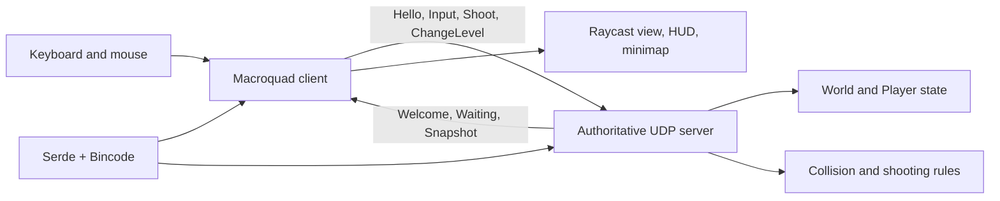

# Maze Wars Project Guide

This document explains the current Maze Wars project: its purpose, structure, concepts, network messages, game flow, rendering, tests, and audit status.

## 1. Project Overview

Maze Wars is a Rust multiplayer first-person maze game. It uses a central UDP server and graphical Macroquad clients.

The project implements:

- A client-server multiplayer architecture.
- Three predefined maze levels.
- A lobby that waits for players and runs a level vote.
- Server-authoritative movement, collision, shooting, kills, deaths, and respawning.
- A first-person raycast maze view.
- A complete-maze minimap in the top-right.
- A top-left HUD showing player name, FPS, kills, and deaths.
- Randomized/separated gameplay concepts where supported by the current server implementation.
- Automated tests for collision and protocol serialization.

The project is a playable prototype. It is not intended to implement the optional bonus features such as AI, procedural maze generation, or a level editor.

## 2. Technology

| Technology | Use |
| --- | --- |
| Rust 2021 | Application and game logic |
| Cargo | Build, dependency, test, and run tool |
| Macroquad | Window, keyboard/mouse input, and 2D drawing |
| UDP sockets | Client-server communication |
| Serde | Serialization derives |
| Bincode | Binary network message encoding |
| Crossterm | Included terminal-related dependency |
| Rand | Available dependency for randomized behavior in project variants |

## 3. Repository Structure

```text
Cargo.toml              Package metadata and dependencies
Cargo.lock              Locked dependency versions
README.md               Assignment requirements
Audit.md                Audit checklist and validation status
PROJECT_GUIDE.md        This document

src/
	lib.rs                Exposes library modules
	main.rs               Default informational binary
	bin/
		client.rs           Active Macroquad client
		server.rs           Active UDP game server
	client/
		mod.rs              Exports the library client module
		app.rs              Small reusable UDP client scaffold
	server/
		mod.rs              Exports the library server module
		app.rs              Small UDP server scaffold
	shared/
		mod.rs              Exports shared modules
		collision.rs        Wall collision and movement
		player.rs           Player data model
		protocol.rs         UDP message definitions
		world.rs            Maze definitions and spawn points

tests/
	game_logic.rs         Collision and protocol integration tests
```

### Active files

The playable application uses `src/bin/client.rs` and `src/bin/server.rs`.

The `src/client/app.rs` and `src/server/app.rs` files are smaller library-level networking examples. They are exported by `src/lib.rs`, but they are not the complete gameplay binaries.

## 4. Build And Run

Run commands from the project directory:

```bash
cargo check
cargo test
cargo run --bin server
cargo run --bin client
cargo run --release --bin server
cargo run --release --bin client
```

The default command only prints a message telling the user to run a binary:

```bash
cargo run
```

### Local match

1. Start the server in one terminal:

	 ```bash
	 cargo run --bin server
	 ```

2. Start at least two clients in separate terminals:

	 ```bash
	 cargo run --bin client
	 ```

3. Enter the server address, normally `127.0.0.1:8080` locally.
4. Enter a username.
5. Choose a level.
6. Press Enter to connect.

For another computer, use the server computer's LAN IP address and allow UDP port `8080` through the firewall/router.

Use release mode when measuring FPS. Debug mode is slower for raycasting and can produce misleadingly low performance numbers.

## 5. Architecture



The client sends intentions. The server decides the actual game state. This is important because a client cannot directly claim a new position or a successful hit.

## 6. Shared Game Data

### Player

`src/shared/player.rs` defines a player record with:

- `id`: numeric player identifier.
- `username`: displayed player name.
- `x`, `y`: maze position.
- `angle`: facing direction in radians.
- `level`: current maze level.
- `kills`: successful shots.
- `deaths`: times the player has been defeated.

### PlayerState

`PlayerState` is the serializable network form of the player state. It is included in server snapshots so every client can draw local and remote players.

### World

`World` contains:

- `width` and `height`.
- A two-dimensional `tiles` grid.
- `spawn_points`, created from walkable cells.

Tile values are simple:

- `1` is a wall.
- `0` is walkable space.

`level_by_index` returns three hard-coded mazes. The levels are 16 by 16, 18 by 18, and 20 by 20, with different wall layouts and increasing maze complexity.

## 7. Network Protocol

The protocol is defined in `src/shared/protocol.rs` and encoded with Serde and Bincode.

### ClientMessage

#### Hello

```rust
Hello {
		username: String,
		protocol_version: u8,
}
```

The client sends this when connecting. The server creates a player and replies with `Welcome`.

#### Input

```rust
Input {
		sequence: u64,
		turn: f32,
		move_forward: f32,
}
```

The client sends movement intentions approximately every 50 milliseconds. It sends turning and forward/backward values rather than a claimed position.

#### Shoot

```rust
Shoot { sequence: u64 }
```

Sent when the player presses Space or left mouse button. The server performs the hit test.

#### ChangeLevel

```rust
ChangeLevel { level: u8 }
```

During the lobby this is the player's level vote. The server stores one vote per connected address and does not immediately change the match level.

#### Disconnect

Sent when the player presses Q. The server removes the player's state.

### ServerMessage

#### Welcome

Contains the assigned player ID and current/default level.

#### Waiting

Contains:

- `connected`: current player count.
- `required`: players required to start, currently 2.
- `level`: current/default level.
- `vote`: the requesting client's own submitted vote, or 0 if none.
- `seconds_left`: lobby countdown remaining.

Each client receives its own `vote` value. This prevents one player from incorrectly seeing another player's selection as their own.

#### Snapshot

Contains the server tick and all connected `PlayerState` values. Snapshots are sent approximately every 50 milliseconds during active gameplay.

#### Error

Available for protocol errors and invalid connection situations.

### UDP behavior

UDP does not guarantee delivery or ordering. The prototype handles this by sending repeated state snapshots. A newer snapshot replaces older state. Important production features such as reliable event acknowledgements and interpolation are not implemented.

## 8. Lobby And Level Voting

The lobby is a timed pre-game phase.

1. The first player joins and waits without a countdown.
2. When the second player joins, a 20-second countdown starts.
3. Players joining during the countdown can submit a level vote.
4. The client lobby displays player count, countdown, default level, and that client's own vote.
5. The server does not choose a level before the timer expires.
6. At the deadline, the level with the most votes is selected.
7. If there is a tie, the current/default level is retained.
8. The selected level is applied to all players with fresh spawns.
9. Gameplay begins and later level changes are locked.

This means that if two players vote for Level 1 and one player votes for Level 2, Level 1 wins. A player joining after the match starts joins the already-selected level rather than changing it.

The lobby is intentionally simple. It is not a bonus matchmaking system and does not include ready buttons, chat, AI, host history, or room browsing.

## 9. Server Flow

The active server is `src/bin/server.rs`.

### Startup

The server:

1. Binds `0.0.0.0:8080`.
2. Makes the UDP socket nonblocking.
3. Creates player, input, last-seen, and shot-timing collections.
4. Starts with Level 1 and an empty lobby.

### Server loop

The server continuously:

1. Reads all available UDP packets.
2. Deserializes each packet.
3. Handles connection, input, shooting, voting, or disconnect actions.
4. Increments its tick.
5. Approximately every 50 ms, removes stale clients, updates movement, and broadcasts waiting state or snapshots.

Clients that send no message for more than three seconds are removed.

### Movement authority

For each player on each update:

1. Read the latest stored input.
2. Clamp turn and movement values.
3. Update the player's angle.
4. Convert forward movement into X/Y movement.
5. Pass the target position through collision handling.
6. Store the safe position.

The client never owns the authoritative position.

## 10. Collision

`src/shared/collision.rs` checks a player-sized circle against nearby wall tiles.

It clamps the target inside the map, tests the X axis, then tests the Y axis. Resolving axes separately allows the player to slide along a wall instead of becoming stuck when moving diagonally into it.

The active server uses a player collision radius of `0.35`.

## 11. Shooting And Respawn

Shooting is decided by the server:

1. Enforce a 250 ms shot cooldown.
2. Find opponents on the same level.
3. Ignore targets beyond 20 units.
4. Check that a target is in front of the shooter.
5. Check sideways distance from the shot direction.
6. Sample the line of sight for walls.
7. Choose the closest visible target.
8. Increment the shooter's kills.
9. Increment the target's deaths.
10. Move the target to a new spawn and reset its angle.

The client displays a short shot flash, but the server decides whether a shot hits.

## 12. Client Flow

The active client is `src/bin/client.rs` and uses Macroquad.

### Connection screen

The client asks for:

- Server IP and port.
- Username.
- Level choice from 1 to 3.

Tab moves between fields. Enter connects. The client sends `Hello`, then sends the selected level as a vote.

### Runtime loop

Each frame the client:

1. Polls available server messages.
2. Stores the newest snapshot or waiting state.
3. Shows the lobby when the match has not started.
4. Reads keyboard and mouse input.
5. Sends input at most every 50 ms.
6. Sends shots when requested.
7. Updates the averaged FPS counter.
8. Draws the first-person view, HUD, minimap, and opponents.
9. Waits for the next Macroquad frame.

### Controls

- W or Up: move forward.
- S or Down: move backward.
- A or Left: turn left.
- D or Right: turn right.
- Space or left mouse button: shoot.
- Q: disconnect and quit.

## 13. Rendering

### First-person view

The client uses a simple raycast renderer. Each screen column creates a ray inside a 90-degree field of view, advances through the maze until it finds a wall, and converts wall distance into wall height.

The scene includes:

- A sky region.
- A floor region.
- Flat-shaded wall columns.
- A center crosshair.
- Visible remote opponents.

The renderer is intentionally simple and uses maze tiles rather than 3D meshes or external assets.

### Opponents

Remote players are drawn only when they are:

- On the same level.
- Inside the view distance.
- Inside the field of view.
- Visible through the maze without a wall blocking the line.

They are represented by simple colored shapes, keeping the visual style close to a classic maze shooter while remaining lightweight.

### Minimap

The minimap shows the entire current maze in a smaller top-right panel:

- Wall cells are drawn separately from walkable cells.
- The local player is green.
- Other same-level players are red.
- Its position is calculated from the screen width so it stays on the right side.

The minimap is required by the assignment and is not removed.

### HUD and FPS

The top-left HUD box displays:

- Maze Wars title.
- Username.
- FPS.
- Kills and deaths.

FPS is calculated over a half-second sample window rather than from one frame. This prevents the number from rapidly changing every frame and makes it readable. FPS is independent of movement because the client continues rendering while the player is idle.

## 14. Tests

Run:

```bash
cargo test
```

The integration tests cover:

- Collision preventing wall entry.
- Bincode round-trip serialization of a protocol message.

The active server and client also compile as test targets. Full real-network testing, packet-loss testing, and sustained multiplayer load testing are not currently automated.

## 15. Audit Status

Locally implemented requirements include:

- Client and server binaries.
- Same-machine server/client play.
- UDP communication.
- IP/port and username entry.
- Graphical game interface.
- Lobby and level voting.
- Three maze levels.
- First-person maze view.
- Full-world minimap and player markers.
- Movement and collision.
- Shooting and respawning.
- Visible FPS counter.
- Local multi-client synchronization.

The remaining audit evidence requires live testing:

1. Connect from a different computer.
2. Run as many clients as practical for at least three minutes.
3. Measure FPS during that sustained multiplayer session.
4. Evaluate smoothness independently from the displayed FPS.

The optional bonus features remain intentionally unimplemented:

- Maze editor.
- Procedural maze generation.
- AI opponents.
- Saved host history and aliases.
- Text chat.

## 16. Complete Match Flow

1. The server binds UDP port 8080.
2. Player 1 connects and enters the waiting lobby.
3. Player 2 connects, starting the 20-second voting countdown.
4. Players submit level choices.
5. The server sends each client its own vote and remaining time.
6. The timer expires and the majority level is selected.
7. All players are placed in that level and gameplay begins.
8. Clients send movement intentions.
9. The server applies movement and collision.
10. The server broadcasts snapshots.
11. Clients render the view, HUD, minimap, and opponents.
12. A shot is checked by the server for direction, distance, and walls.
13. A defeated player receives a new spawn and the snapshot reports updated kills/deaths.
14. A stale or disconnected client is removed.

This is how the user interface, protocol, server authority, shared world, collision system, rendering, and tests fit together.
